# gingaf

`gingaf` is an MIT-licensed, multi-platform implementation of the interactive TV middleware Ginga standardised by ITU-T and SBTVD.

You can use `gingaf` to develop Ginga applications at web by using the playground or acessing [ginga.org.br/gingaf/playground](https://ginga.org.br/gingaf/playground), or at desktop by the Visual Studio Code extension [ginga-code](https://github.com/ginga-org-br/ginga-code).

## Documentation

The `gingaf` documentation is available at [https://ginga-org-br.github.io/gingaf/docs](https://ginga-org-br.github.io/gingaf/docs). The repository is organized as a monorepo: the root directory contains the Flutter host application. It include the following packages: [`packages/gingacc`](packages/gingacc) (configuration, users, and CCWS), [`packages/ncldoc`](packages/ncldoc) (NCL headless execution engine), [`packages/nclui`](packages/nclui) (NCL and visual widgets), and [`node`](node) (npm package and web interactive playground).

## Selected Applications

<table>
  <tbody>
    <tr>
      <td align="center" width="50%">
         
        NCL with basic links (<a href="https://ginga.org.br/gingaf/playground/?app=video.ncl">video.ncl</a>)
      </td>
      <td align="center" width="50%">
         
        NCL with videos grid (<a href="https://ginga.org.br/gingaf/playground/?app=video_grid.ncl">video_grid.ncl</a>)
      </td>
    </tr>
    <tr>
      <td align="center" width="50%">
         
        NCL embedded with NCL (<a href="https://ginga.org.br/gingaf/playground/?app=emb_ncl.ncl">emb_ncl.ncl</a>)
      </td>
      <td align="center" width="50%">
         
        NCL with focus navigation and selection (<a href="https://ginga.org.br/gingaf/playground/?app=focus_nav.ncl">focus_nav.ncl</a>)
      </td>
    </tr>
    <tr>
      <td align="center" width="50%">
         
        NCL with lua canvas drawing and keys (<a href="https://ginga.org.br/gingaf/playground/?app=lua_canvas.ncl">lua_canvas.ncl</a>)
      </td>
      <td align="center" width="50%">
         
        HTML with CCWS /current-service/ (<a href="https://ginga.org.br/gingaf/playground/?app=current_service.html">current_service.html</a>)
      </td>
    </tr>
    <tr>
      <td align="center" width="50%">
         
        NCL with embedded HTML document (<a href="https://ginga.org.br/gingaf/playground/?app=emb_html.ncl">emb_html.ncl</a>)
      </td>
      <td align="center" width="50%">
         
        NCL with multi-user profile switching and targeted advertising (<a href="https://ginga.org.br/gingaf/playground/?app=multiuser_profile/main.ncl">multiuser_profile/main.ncl</a>)
      </td>
    </tr>
  </tbody>
</table>

## Multi-platform Demos

<table>
  <tbody>
    <tr>
      <td align="center" width="50%">
         
        Windows
      </td>
      <td align="center" width="50%">
         
        Android
      </td>
    </tr>
    <tr>
      <td align="center" width="50%">
         
        Chrome
      </td>
      <td align="center" width="50%">
         
        CLI (headless execution)
      </td>
    </tr>
  </tbody>
</table>

## Launch application from Visual Studio Code

